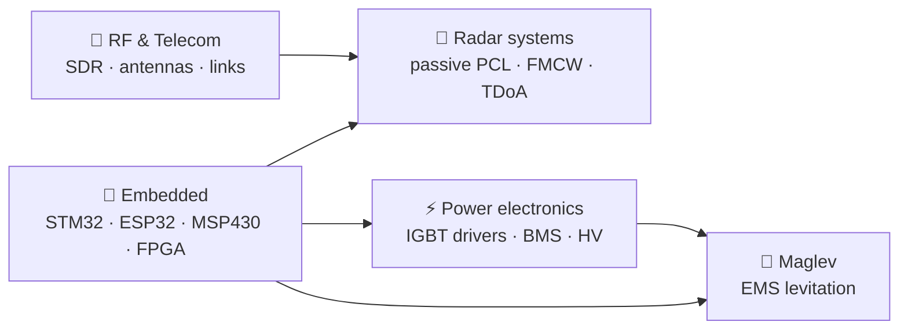

# Muhammadamin Qodirov

### Radar · RF & Telecommunications · Power Electronics · Embedded

Electrical & Electronics Engineering, **KTÜ — Karadeniz Technical University**, Trabzon 🇹🇷
I build things that sense, transmit and switch: SDR radars with HackRF, RF measurement stations, IGBT drivers and levitation control.

---

## 🛰️ What I work on

| Area | What I have done |
|---|---|
| 🎯 **Radar** | Passive coherent location (PCL) on LTE illuminators: 4+1 HackRF array, own 10 MHz clock-distribution PCB, CAF / CFAR / DoA chain (internship). Active FMCW radar next, cable-first. |
| 📡 **RF & telecom** | "Can a tree be an antenna?" — 24/7 station with two HackRF receivers, NanoVNA S11 / TDR, 0–300 MHz sweeps. Wi‑Fi / LoRa / CAN‑FD link budgets for a levitation pod. |
| ⚡ **Power electronics** | EMS‑3L: 3‑leg IGBT driver board (6× IKW30N65ES5, isolated gate drivers, 4‑layer PCB, 0 DRC errors), 12S Li‑ion pack with BQ76952 BMS, LTspice HV studies. |
| 🧲 **Control** | Cascade current‑PI (20 kHz) + gap‑PID (5 kHz) and modal control for a 4‑magnet levitation pod — TÜBİTAK project. |
| 🔌 **Embedded** | Register‑level STM32, MSP430 ↔ STM32 buses, ESP32 Wi‑Fi / HTTP / MQTT, 8051 assembly, VHDL with testbenches. |

---

## ⭐ Projects

### Research & hardware (🔒 private while in progress — happy to show on request)

| Project | Stack |
|---|---|
| **EMS Levitation Demonstrator** — desk‑scale maglev pod, 20 kg, 6 mm gap, 4 electromagnets. Magnet design, EMS‑3L IGBT driver (KiCad), 12S battery + BMS, cascade/modal control, CAN‑FD comms. *TÜBİTAK, KTÜ.* | STM32G474 · KiCad · Python sim |
| **Tree‑Antenna RF Monitor** — a living ~20 m tree as a receiving antenna: two HackRF One, NanoVNA, camera, weather; per‑minute spectra, 30‑min averages, desktop apps in EN/RU/TR. | HackRF · NanoVNA · Python · Qt |
| **Passive Radar (PCL)** — LTE‑based passive radar with a 4‑element λ/2 array, shared 10 MHz reference, ECA/NLMS clutter cancellation, FFT cross‑ambiguity, CFAR, bistatic tracking. | HackRF ×5 · Python DSP · KiCad |

### Open repositories

| Repo | What |
|---|---|
| [**embedded-systems-labs**](https://github.com/Bugee03/embedded-systems-labs) | STM32 register level, Nuvoton M031 (24 projects), MSP430 ↔ STM32 I²C/SPI/UART, ESP32, 8051 ASM + C, VHDL, Basys 3 FPGA course |
| [**telecom-dsp-labs**](https://github.com/Bugee03/telecom-dsp-labs) | I/Q & QPSK, Hamming (7,4) over a noisy channel, FIR/IIR filters (ECG, equalizer), white noise, source coding |
| [**pcb-design-kicad**](https://github.com/Bugee03/pcb-design-kicad) | my KiCad 10 course + `pcb_calc.py` (IPC‑2221 width, microstrip Z₀, CPWG) and `kicad_inspect.py` |
| [**control-systems-labs**](https://github.com/Bugee03/control-systems-labs) | DC motor: transfer function, state space, canonical forms, PID (MATLAB / Simulink); Bode, Nyquist, root locus |
| [**esp32-ultrasonic-wifi-monitor**](https://github.com/Bugee03/esp32-ultrasonic-wifi-monitor) | ESP32 + HC‑SR04, Wi‑Fi, HTTP endpoint, live web client, MQTT variant |
| [**jump-analyzer-imu**](https://github.com/Bugee03/jump-analyzer-imu) | wearable jump analyzer: STM32F103 + MPU‑9250 + 2× HX711 load cells (KiCad) |
| [**power-electronics-hv**](https://github.com/Bugee03/power-electronics-hv) | LTspice: voltage doubler, 3‑stage cascaded HV test transformer |
| [**python-iot-labs**](https://github.com/Bugee03/python-iot-labs) | UART JSON telemetry gateway → SQLite, sensor simulator, pytest |
| [**programming-foundations**](https://github.com/Bugee03/programming-foundations) | C / C++ for embedded: memory, stack & ISR, assembly output, RAII, Rule of Five |

---

## 🧰 Toolbox

| | |
|---|---|
| **RF / SDR** | HackRF One, NanoVNA, spectrum analyzer, Yagi & wideband antennas |
| **Hardware** | KiCad 10 (4‑layer, Gerber/BOM/CPL), LTspice |
| **MCU / FPGA** | STM32 (CubeIDE, bare metal), Nuvoton M031 (gcc + pyOCD), ESP32 (ESP‑IDF, FreeRTOS), MSP430 (CCS), 8051 (SDCC), Basys 3 (VHDL, Verilog) |
| **Software** | Python (NumPy, SciPy, Matplotlib, Qt, Jupyter), C, C++, MATLAB / Simulink, Git, Linux (Fedora), macOS terminal |
| **Buses & links** | UART, SPI, I²C, Wi‑Fi, MQTT · designed: CAN‑FD, LoRa |

## 🌱 Now

- 🎯 Moving the passive radar to LTE and writing it up as a paper (ADS‑B / AIS ground truth)
- 🧲 Ordering the EMS‑3L boards and first one‑axis levitation
- 📡 Starting an active FMCW radar — over cable first

Docs in English · Русский · Türkçe

